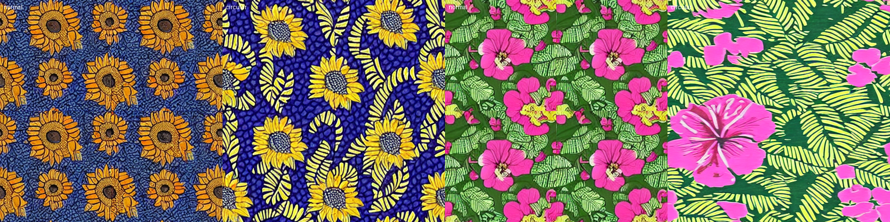
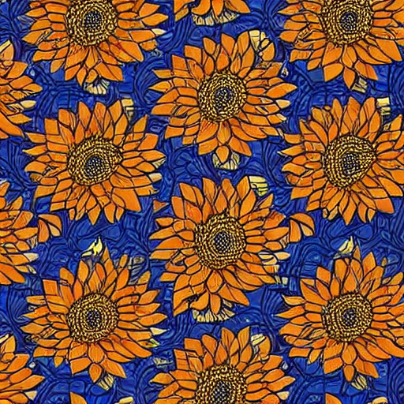
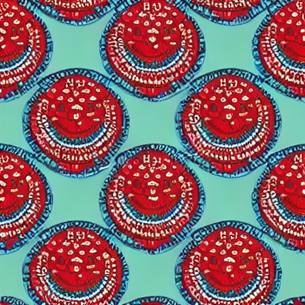
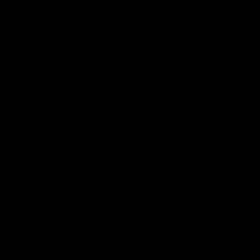

# AnkaraGen

Fine-tuning Stable Diffusion 1.5 with LoRA to generate Ankara (wax print) fabric patterns, with an optional seamless-tiling mode.

## The problem

Ask base Stable Diffusion for an "ankara print" and you get something that looks like a decorative *painting*: a focal point, lighting, depth. Real fabric is flat and evenly dense, with motifs arranged to repeat. This project teaches the model the second meaning.

## What I built

- **Dataset:** 20 hand-cropped 512x512 Ankara images, each with a hand-written caption (motif, colors, background, scale), all starting with the trigger phrase `ankara print`.
- **Training:** LoRA (rank 4) on Stable Diffusion 1.5 using Hugging Face `diffusers`. 1,000 steps, effective batch size 4, learning rate 1e-4 with cosine decay, fp16, on a free Kaggle T4 GPU. About 26 minutes.
- **Seamless tiling:** switching the UNet and VAE convolutions to circular padding at generation time, with no retraining.
- **Demo:** a Gradio app with a prompt box, a tileable toggle, and a 2x2 repeat preview.

## Results

**Before (base model) vs after (LoRA), same prompts and seeds:**

 

   

**What the comparison showed:**
- The LoRA outputs look flatter and more like printed cloth than the base model's.
- It followed new prompts (colors and motifs not in any training caption) without copying the training photos.
- A non-Ankara prompt (a cat on a sofa) still worked, so the base model's general ability survived.

**Checkpoint comparison:** I compared steps 500, 750 and 1000 on four prompts with one seed each. I preferred step 1000 for more vivid color and a more convincing Ankara look. This is a small, subjective test.

**Seed variance:** on one prompt I generated 8 seeds. Roughly half gave results I'd call good. Seeds are independent random starting points, so some are simply better than others. I'd recommend generating several and picking.

## Seamless tiling

By default, convolutions pad image borders with zeros, so nothing makes the left edge match the right. Circular padding wraps the borders around, so the edges line up.

- With tiling on, the 2x2 repeat preview looks continuous.
- The tiled output differs in composition from the untiled output for the same seed, because the LoRA was trained without circular padding. Retraining with circular padding enabled would be the principled fix.
- I judged seams by eye on 2x2 previews. I did not run a quantitative seam metric.

## Limitations

- Trained on only 20 images, so variety is limited.
- Outputs are 512x512, which is too small to print on fabric without upscaling.
- Roughly half of generations are usable; geometric patterns are harder.
- **Training images are not included in this repo.** Several came from web sources with unknown licenses, and I have not published them. A commercial version would need a dataset I own or have permission to use.
- Stable Diffusion's built-in safety checker produced a false positive (a black image) on one tiled output, so it is disabled in my demo. A public deployment should consider this.

## Repo contents

- `ankaragen.ipynb`: training and generation code (outputs cleared)
- `scripts/`: data preparation (crop, rename, caption template, JSONL builder)
- `captions.txt`: the 20 captions
- `results/`: before/after, tiling and seed-sweep images

## What I learned
one things that comes to mind of all things ive learned building this project is the power of perseverance, and going through with a project right after starting it even though it might seem tasking but OMG, how rewarding it is to have built this
## Stack

Python, PyTorch, Hugging Face diffusers / peft / accelerate, Gradio, Kaggle.
